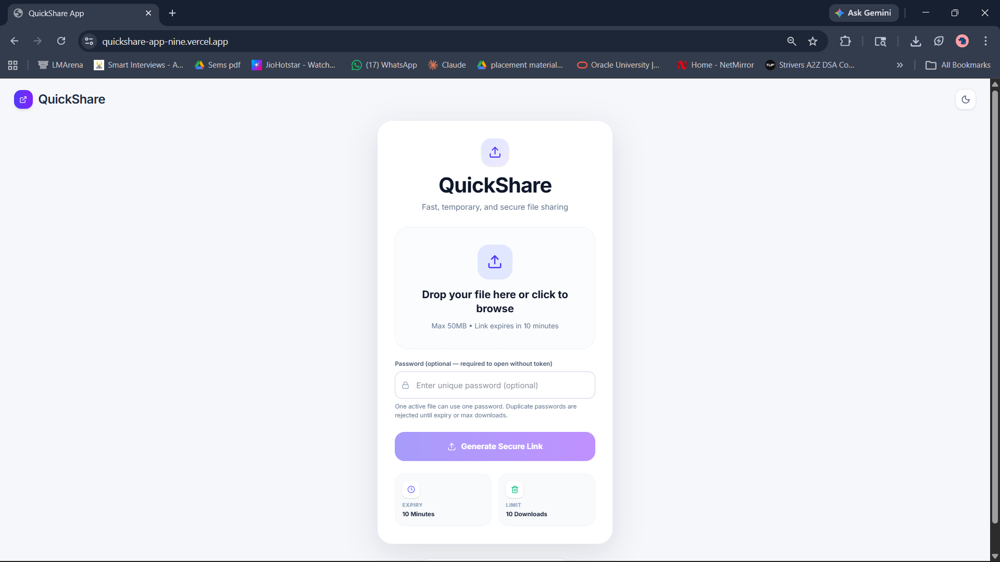
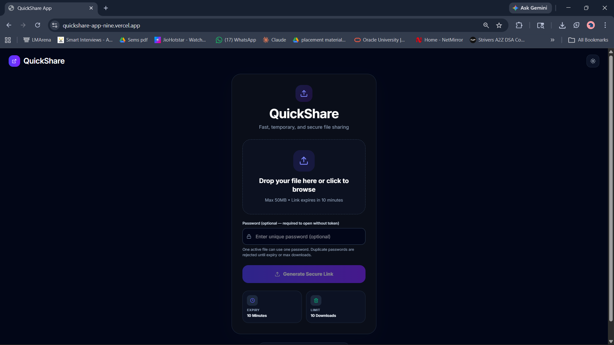
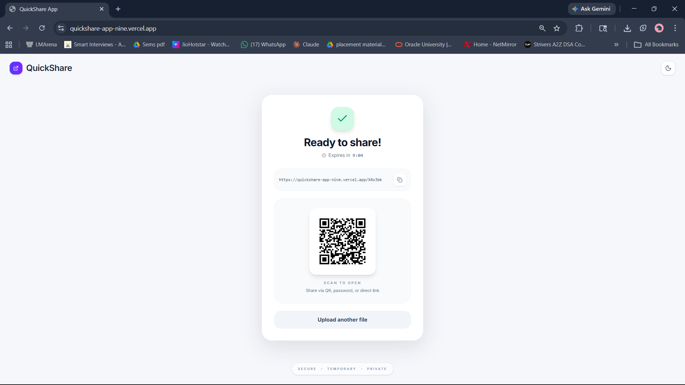
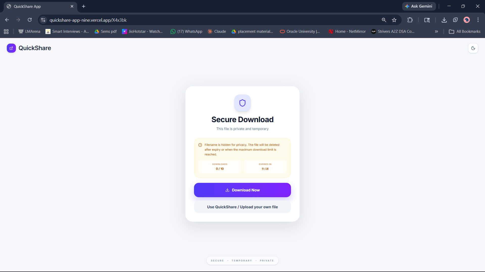

# 🚀 QuickShare

QuickShare is a fast, secure, and temporary file-sharing web application that allows users to upload files and generate short, shareable links with expiration and download limits.

---

## 🌐 Live Demo

👉 https://quickshare-app-nine.vercel.app

---

## 📸 Screenshots

<p align="center">
  
  
</p>

<p align="center">
  
  
</p>

---

## ✨ Features

- 📤 Drag & drop file upload
- 🔗 Short and clean shareable links
- ⏳ Auto file expiration (10 minutes)
- 🔐 Optional password protection
- 📥 Download limits (max downloads)
- ⚡ Instant file access via secure links
- ☁️ Cloud storage using Vercel Blob
- 🧠 Metadata storage using Vercel KV (Redis)

---

## 🏗 Architecture

```
Frontend (React + Vite)
        ↓
Vercel Serverless Functions (API)
        ↓
Vercel Blob (File Storage)
        +
Vercel KV (Metadata Storage)
```

---

## 🛠 Tech Stack

### Frontend

- React
- TypeScript
- Vite

### Backend

- Vercel Serverless Functions
- Node.js

### Storage

- Vercel Blob (File storage)
- Vercel KV (Redis for metadata)

### Deployment

- Vercel

---

## 📁 Project Structure

```
quickshare-app
 ├── api
 │   ├── upload.ts
 │   ├── file-info.ts
 │   ├── download
 │   │   └── [id].ts
 │   └── store.ts
 │
 ├── src
 │   ├── App.tsx
 │   ├── main.tsx
 │   └── styles
 │
 ├── index.html
 ├── package.json
 ├── vite.config.ts
 └── vercel.json
```

---

## ⚙️ Environment Variables

Create a `.env` file:

```
BLOB_READ_WRITE_TOKEN=your_blob_token
KV_REST_API_URL=your_kv_url
KV_REST_API_TOKEN=your_kv_token
```

---

## 🚀 Run Locally

### 1. Clone the repository

```
git clone https://github.com/kirankumarsuryavamshi34-web/quickshare-app.git
cd quickshare-app
```

### 2. Install dependencies

```
npm install
```

### 3. Start development server

```
npm run dev
```

---

## 🚀 Deployment

Deployed on **Vercel**

- Automatic deployment on push to `main`
- Serverless backend + edge storage

---

## 📌 Future Improvements

- 📊 File analytics dashboard
- 📱 QR code sharing
- 👀 File preview before download
- 🔗 Custom short links
- 🌐 Custom domain support

---

## 📄 License

This project is open-source and available under the MIT License.

---

## 👨‍💻 Author

**Suryavamshi Kiran Kumar**

- GitHub: https://github.com/kirankumarsuryavamshi34-web
- LinkedIn: https://linkedin.com/in/suryavamshi-kiran-kumar
